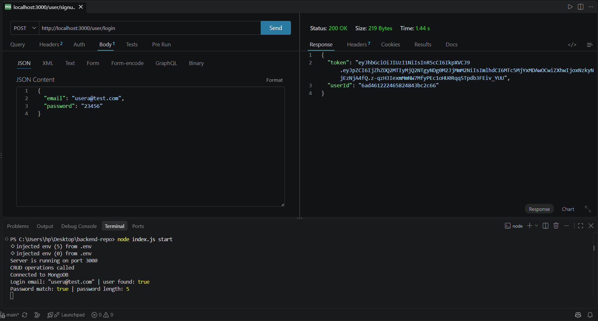
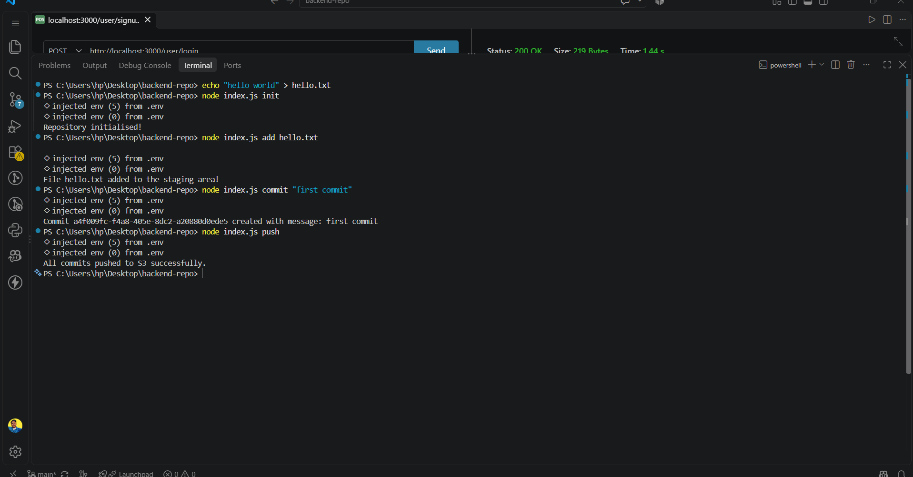

<div align="center">

# ⚙️ GitHub Clone — Backend

**REST API + a tiny Git of its own. Handles users, JWT login, repositories, issues and a CLI version-control system.**

[🚀 Live Demo](https://main.d1jwxcdr5bwis6.amplifyapp.com/) · [🎥 Demo Video](https://youtu.be/K1VGrIL52ZQ) · [🖥️ Frontend Repo](https://github.com/abhi7044/aws-frontend-demo)



]
  B --> D[(AWS S3<br/>mini Git commits)]
```)

</div>

---

## ✨ What it does

- 🔐 **Authentication:** sign-up and login with bcrypt-hashed passwords and JWT tokens
- 🛡️ **Middleware:** token verification and authorization helpers
- 📦 **Repositories:** create, read, update, delete and toggle visibility
- 🐞 **Issues:** issue routes and controller per repository
- 🔄 **Socket.IO:** per-user rooms for real-time events
- 🌿 **Built-in version control (CLI):** my own mini Git — `init`, `add`, `commit`, `push`, `pull`, `revert`

---

## 🌿 The mini Git (my favourite part)

The same `index.js` that starts the server also works as a command-line tool, built with **yargs**.

| Command | What it does |
|---|---|
| `node index.js init` | Creates a hidden `.apnaGit` repository with `commits` and `staging` folders |
| `node index.js add <file>` | Stages a file |
| `node index.js commit "<message>"` | Saves the staged files as a commit |
| `node index.js push` | Uploads commits to **AWS S3** |
| `node index.js pull` | Downloads commits from S3 |
| `node index.js revert <commitID>` | Restores files from an earlier commit |
| `node index.js start` | Starts the API server |

---

## 🧱 Tech Stack

Node.js · Express · MongoDB (Mongoose) · JWT · bcryptjs · Socket.IO · yargs · AWS S3 · AWS EC2 + PM2

---

## 🔌 API Reference

### Users — `/user`

| Method | Endpoint | Description |
|---|---|---|
| POST | `/user/signup` | Create an account |
| POST | `/user/login` | Log in, receive token and user id |
| GET | `/user/allUsers` | List users |
| GET | `/user/userProfile/:id` | Get one user |
| PUT | `/user/updateProfile/:id` | Update email or password |
| DELETE | `/user/deleteProfile/:id` | Delete a user |

### Repositories — `/repo`

| Method | Endpoint | Description |
|---|---|---|
| POST | `/repo/repo/create` | Create a repository |
| GET | `/repo/repo/all` | List all repositories |
| GET | `/repo/repo/:id` | Get by id |
| GET | `/repo/repo/name/:name` | Get by name |
| GET | `/repo/repo/user/:userId` | Repositories of a user |
| PUT | `/repo/repo/update/:id` | Update |
| PATCH | `/repo/repo/toggle/:id` | Toggle visibility |
| DELETE | `/repo/repo/delete/:id` | Delete |

### Issues — `/issue`

See `routes/issue.router.js` for the issue endpoints.

---

## 📁 Project structure

```
backend/
├── config/         AWS S3 setup
├── controller/     user, repo, issue + CLI commands (init, add, commit, push, pull, revert)
├── middleware/     authMiddleware, authorizeMiddleware
├── models/         userModel, repoModel, issueModel
├── routes/         main, user, repo, issue routers
└── index.js        Server + CLI entry point
```

---

## 🚀 Run it locally

```bash
npm install
```

Create a `.env` file:

```
MONGODB_URI=<your MongoDB connection string>
JWT_SECRET_KEY=<a long random string>
PORT=3000
```

Then start the server:

```bash
node index.js start
```

> 🔒 `.env` is git-ignored. Never commit your secrets.

---

## ☁️ Deployment

Runs on an **AWS EC2** instance, kept alive by **PM2**:

```bash
pm2 start index.js --name github-backend -- start
pm2 save && pm2 startup
```

To ship a change: `git push` → on the server run `git pull` and `pm2 restart github-backend`.

---

## 🧠 What I learned

- Designing a REST API with clear route, controller and model layers
- Password hashing and stateless auth with JWT
- Building a CLI with yargs and storing data on AWS S3
- Running a Node server in production with PM2 on EC2, and debugging CORS and networking issues

---

<div align="center">

Built by **Abhijeet Mishra** · [GitHub](https://github.com/abhi7044) · [LinkedIn](PASTE_LINKEDIN_LINK_HERE)

</div>
